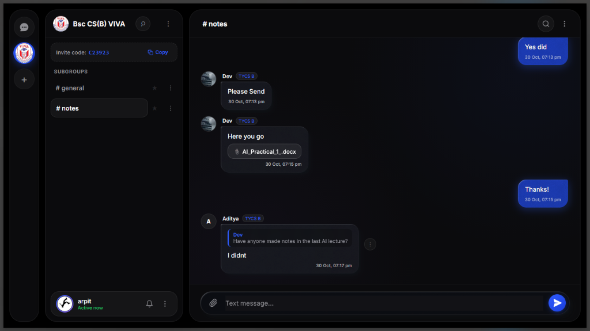
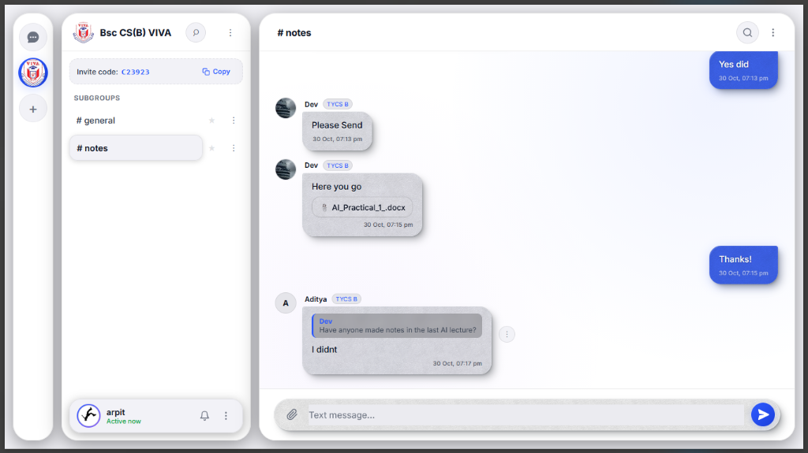
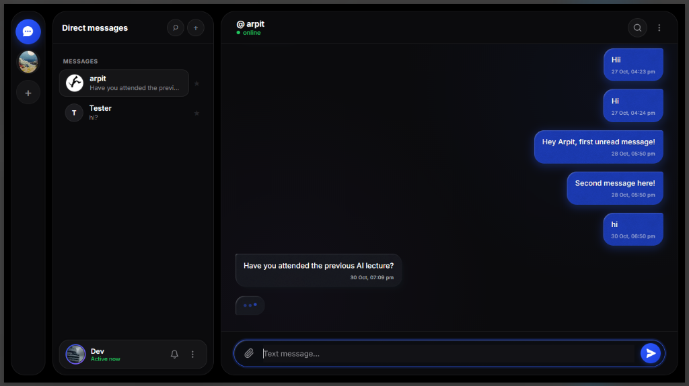
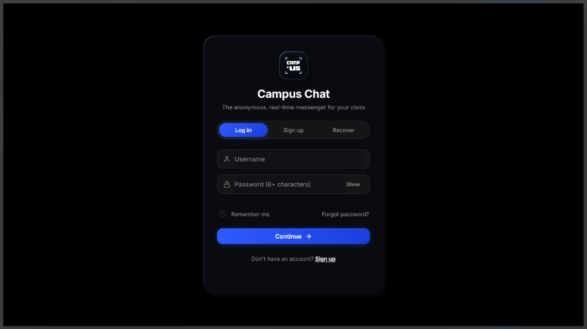
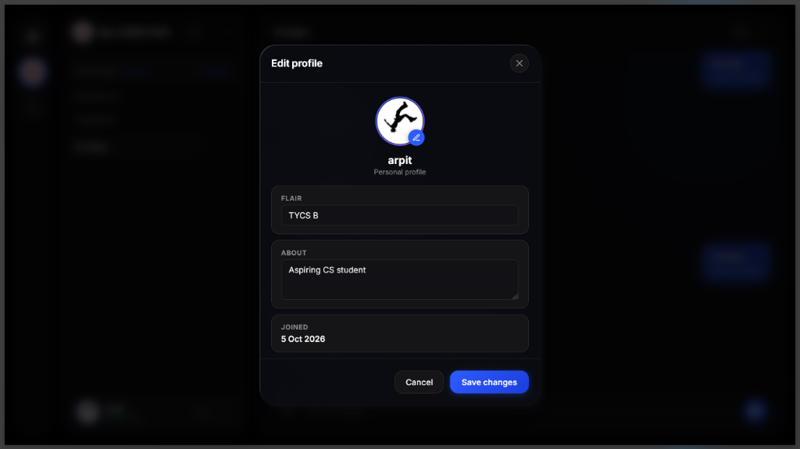
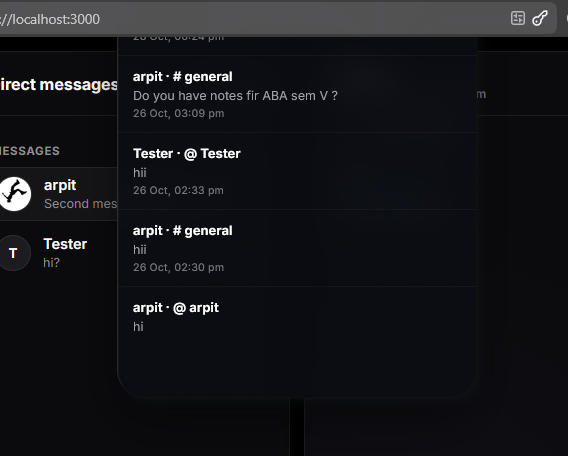

#  CampUS Chat

> **The anonymous chat space for your class.**

A real-time chat platform built for students to connect with classmates, share notes, discuss topics, and keep up with class announcements.

<p align="center">
  <a href="#features">Features</a> •
  <a href="#tech-stack">Tech Stack</a> •
  <a href="#getting-started">Getting Started</a> •
  <a href="#project-structure">Project Structure</a> •
  <a href="#deployment">Deployment</a>
</p>

<p align="center">
  
  
  
  
  
</p>

---

## ✨ Features

- **Accounts & Authentication** — Sign up, log in, and recover accounts using a one-time recovery code. Includes "Remember me" session persistence (unticked logs out upon browser refresh), password reveal toggle, and smooth tab navigation.
- **3D Glassmorphism Design (`.glass3d`)** — Bespoke tactile frosted glass surfaces with multi-layered specular highlights, noise textures, backdrop blurring, and high-contrast typography readable across both dark and light modes.
- **Interactive 3D Motion & Parallax** — Cursor-following 3D perspective tilt with spring physics on the authentication card and modals for a fluid, tactile feel.
- **Centered Modal Architecture** — User profiles, personal profile editor, notifications, and search all utilize standardized `<dialog>` modals with dimmed backdrop blur, eliminating off-screen clipping.
- **Smart Notification System** — Dedicated dock notification trigger, unread notification count badges, unread activity dot indicators across Direct Message and Community navigation, single unread bold message preview under usernames, and "Mark all read" controls.
- **Brand Identity & Vector Monogram** — Integrated CampUS Monogram Badge branding with angular corner brackets and brutalist lettering, plus automatic dark/light mode SVG favicons.
- **Modern React Component Library Support** — shadcn UI structure, Tailwind CSS, TypeScript configuration, and modular components (`components/ui/sign-in-card-2.tsx` and `components/ui/demo.tsx`) with Framer Motion animations.
- **Communities & channels** — Create communities, invite classmates with one-click invite code copying, and manage channels such as `general`, `notes`, and `memes`. Owners can edit the community name, picture, and description, and permanently delete a group with all its channels and shared content for every member.
- **Real-time chat** — Messages, typing indicators, presence, and notifications update instantly through Socket.IO.
- **Direct messages** — Start private conversations with other users.
- **Replies** — Reply directly to messages to keep conversations organized.
- **File sharing** — Send attachments up to **50 MB**.
- **Profiles** — Edit your avatar, flair, and bio in a profile-style settings window with a circular picture editor and join date; view other users' profiles.
- **Search** — Search conversations or narrow results to the current chat.
- **Pinned chats** — Keep important channels and DMs at the top of your list.
- **Clear chat** — Hide existing messages from your own view without deleting them for others.
- **Themes** — Switch between light and dark mode with persistent preferences and adaptive assets.
- **Responsive UI** — Works across desktop and mobile layouts.

---

## 🛠 Tech Stack

| Layer | Technology |
|---|---|
| Runtime | Node.js 18+ |
| Server | Express 4.x |
| Real-time communication | Socket.IO 4.x |
| Database | SQLite + `better-sqlite3` |
| Frontend | HTML, CSS, JavaScript (Vanilla zero-build client) |
| Component Library & Styling | Tailwind CSS, Framer Motion, Lucide React, shadcn UI Structure |
| Language & Types | TypeScript (`tsconfig.json`), JavaScript |
| Authentication | JWT + bcrypt |
| Package manager | npm |

No frontend build step is required for the live client.

---

## 📸 Screenshots

<p align="center">
  
  
</p>

<p align="center">
  
  
</p>

<p align="center">
  
  
</p>

> Use screenshots with test accounts only. Do not include passwords, recovery codes, `.env` files, or private student information.

---

## 🚀 Getting Started

### Requirements

- [Node.js](https://nodejs.org/) 18 or newer
- npm

### 1. Clone the repository

```bash
git clone https://github.com/V4RPIT/Campuschat-glass-version.git
cd Campuschat-glass-version
```

### 2. Install dependencies

```bash
npm install
```

### 3. Configure environment variables

Create a `.env` file from the example:

**PowerShell**
```powershell
Copy-Item .env.example .env
```

**macOS / Linux**
```bash
cp .env.example .env
```

Set a strong `JWT_SECRET` inside `.env`.

### 4. Start the server

```bash
npm start
```

Open:

```text
http://localhost:3000
```

For development with automatic server restarts:

```bash
npm run dev
```

---

## ⚙️ Configuration

| Variable | Purpose | Default |
|---|---|---|
| `PORT` | HTTP server port | `3000` |
| `JWT_SECRET` | Secret used to sign login tokens | Set your own |
| `SIGNUP_INVITE` | Optional code required for signup | Empty |
| `DB_PATH` | SQLite database path | `./chat.db` |
| `NODE_ENV` | Runtime environment | Unset |

**Do not commit `.env`.**

For production, use a strong `JWT_SECRET`. The server refuses to start in production with the built-in development secret.

---

## 🔌 How It Works

```text
                    ┌─────────────────────┐
                    │      Browser        │
                    │ HTML / CSS / JS     │
                    └──────────┬──────────┘
                               │
                  ┌────────────┴────────────┐
                  │                         │
              HTTP / JSON              Socket.IO
                  │                         │
                  ▼                         ▼
        ┌──────────────────┐       ┌──────────────────┐
        │   Express API    │       │  Realtime Events │
        └────────┬─────────┘       └────────┬─────────┘
                 │                          │
                 └──────────┬───────────────┘
                            ▼
                    ┌───────────────┐
                    │    SQLite     │
                    │  better-sqlite3│
                    └───────────────┘
```

The Express API handles authentication, profiles, communities, messages, search, notifications, and attachments.

Socket.IO handles live messages, typing indicators, presence, and other real-time updates.

The server checks authentication and conversation access before returning protected data or delivering events.

---

## 📁 Project Structure

```text
CampUS/
├── components/          # Reusable UI component library (shadcn / React)
│   └── ui/
│       ├── sign-in-card-2.tsx  # 3D interactive sign-in card component
│       └── demo.tsx            # Component demo wrapper
├── lib/
│   └── utils.ts         # Utility functions (cn, clsx, tailwind-merge)
├── Logos/               # Vector SVG and PNG brand badges & monograms
│   ├── campus_monogram_badge_black.svg
│   ├── campus_monogram_badge_white.svg
│   └── ...
├── docs/
│   └── screenshots/     # Application screenshots
├── public/
│   ├── index.html       # Main UI & modal dialogs
│   ├── style.css        # Layout, 3D glass styles & themes
│   ├── app.js           # Client-side logic & 3D tilt engine
│   └── favicon.svg      # Dynamic theme favicon
├── server.js            # Express server, API, DB and Socket.IO
├── components.json      # shadcn configuration
├── tsconfig.json        # TypeScript configuration
├── package.json         # Dependencies and scripts
├── package-lock.json    # Locked dependency versions
├── .env.example         # Environment configuration template
├── About.txt            # Extended project documentation
└── README.md            # Project documentation
```

The SQLite database (`chat.db` by default) is created when the server starts.

---

## 🔐 Security

- Passwords and recovery codes are stored as bcrypt hashes.
- Authentication uses signed JWTs.
- Login and signup/recovery attempts are rate-limited.
- Signup includes a honeypot field and can optionally require an invite code.
- Community membership is checked on the server.
- Attachment access is protected by server-side checks.
- Production mode requires a custom `JWT_SECRET`.

### Current limitations

- No email verification.
- No CAPTCHA.
- No multi-factor authentication.
- Online presence is stored in server memory.
- Pinned chats and theme preferences are browser-local.
- Attachments are stored in SQLite.
- The current realtime design is intended for a single server instance.

---

## ☁️ Deployment

CampUS can be deployed to a Node.js hosting service such as Render, Railway, or Fly.io.

### Basic setup

1. Connect the repository to your hosting provider.
2. Install dependencies:

```bash
npm install
```

3. Start the server:

```bash
npm start
```

4. Set:

```text
NODE_ENV=production
JWT_SECRET=<strong-random-secret>
```

5. Configure `SIGNUP_INVITE` if signup should require an invite code.
6. Use persistent storage for the SQLite database and set `DB_PATH` accordingly.

> SQLite data can be lost if your hosting provider uses an ephemeral filesystem. Use a persistent disk or volume for production.

The current Socket.IO/presence setup is intended for a single server instance. Running multiple instances requires shared Socket.IO coordination and shared persistence.

---

## 📄 License

This project is licensed under the **MIT License**.
